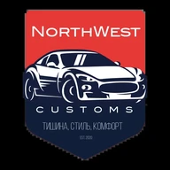
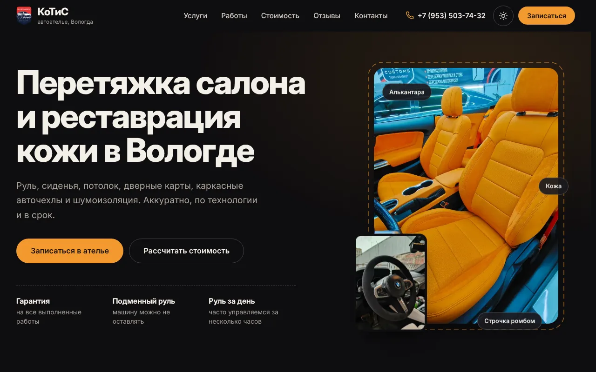
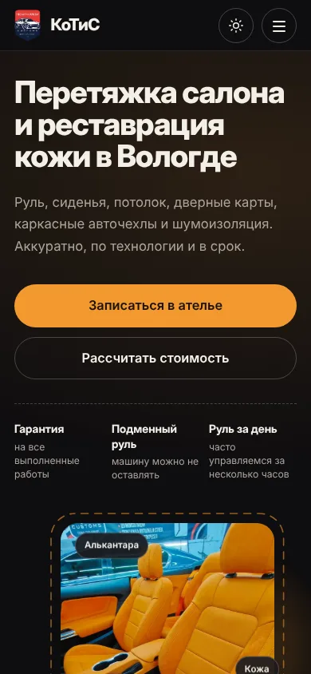
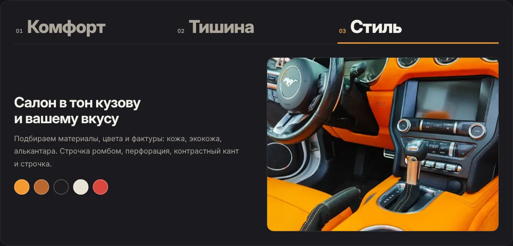

<div align="center">



# АвтоАтелье «КоТиС»

**Сайт автоателье в Вологде: перетяжка салона, авточехлы, реставрация кожи, шумоизоляция**

Статический сайт без сборки: HTML, CSS и JavaScript. Тёмная и светлая темы, плавные анимации, удобен на телефоне.




</div>

---

## Что на сайте

| Раздел | Что внутри |
|---|---|
| **Главный экран** | Заголовок по словам, живое фото с бегущей «строчкой», быстрые кнопки «Записаться» и «Рассчитать» |
| **Услуги и цены** | Три главные услуги карточками (на телефоне листаются пальцем), остальные списком, кнопка «Заказать» |
| **Комфорт, тишина, стиль** | Три вкладки с анимацией и мозаика преимуществ |
| **Наши работы** | 8 фото на странице, окно «Все работы» с фильтрами по категориям (73 фото) и просмотром |
| **Стоимость** | Калькулятор: отмечаете услуги, видите сумму «от», отправляете расчёт в заявку |
| **Как мы работаем** | Четыре шага, соединённые «нитью» |
| **Отзывы** | Лента отзывов с Яндекс Карт, рейтинг 5,0 |
| **Частые вопросы** | Плавно раскрывающиеся ответы |
| **Запись** | Форма с маской телефона и выбором нескольких услуг |
| **Контакты** | Адрес, телефоны, ВКонтакте, способы оплаты, карта Яндекса |

<div align="center">

&nbsp;&nbsp;

</div>

## Особенности

- **Без сборки и зависимостей.** Откройте `index.html` двойным кликом, и сайт работает.
- **Плавность.** Анимируются только `transform` и `opacity`, без размытия и тяжёлых фильтров.
- **Телефон в приоритете.** Карусель услуг, нижняя кнопка «Позвонить», окна на всю высоту экрана с учётом адресной строки.
- **Доступность.** Навигация с клавиатуры, подписи для экранных дикторов, режим «уменьшить анимацию» показывает всё сразу.
- **Две темы.** Тёмная по умолчанию, светлая по настройке устройства и переключателю; выбор запоминается.
- **SEO.** Описание, Open Graph, микроразметка LocalBusiness, `sitemap.xml`, `robots.txt`, манифест, страница 404.
- **Быстрая загрузка.** Фото в WebP, шрифты Inter в подмножестве (кириллица + латиница) лежат в проекте.

## Быстрый старт

```text
1. Скачайте репозиторий (Code → Download ZIP) и распакуйте.
2. Откройте index.html в браузере.
```

Чтобы посмотреть сайт через локальный сервер (ближе к реальной работе):

```bash
python3 -m http.server 8000
# откройте http://localhost:8000
```

## Публикация

Сайт публикуется на GitHub Pages автоматически при каждом обновлении ветки `main`.
Пошаговая инструкция без терминала: [docs/DEPLOY.md](docs/DEPLOY.md).

## Как менять содержимое

| Что поменять | Где | Подробнее |
|---|---|---|
| Телефон, ссылка на ВК, фото на странице | `assets/js/config.js` | [docs/EDITING.md](docs/EDITING.md) |
| Цены и названия услуг | `index.html`, атрибут `data-price` (калькулятор подхватит сам) | [docs/EDITING.md](docs/EDITING.md) |
| Тексты, отзывы, вопросы | `index.html` | [docs/EDITING.md](docs/EDITING.md) |
| Куда приходят заявки | `formEndpoint` в `assets/js/config.js` | [docs/EDITING.md](docs/EDITING.md) |
| Цвета и скругления | `assets/css/tokens.css` | [docs/STRUCTURE.md](docs/STRUCTURE.md) |
| Анимации | `assets/css/motion.css`, `assets/js/motion.js` | [docs/ANIMATIONS.md](docs/ANIMATIONS.md) |

## Структура проекта

```text
├── index.html              страница сайта
├── 404.html                страница «не найдено»
├── site.webmanifest        манифест (иконки, цвета)
├── robots.txt, sitemap.xml для поисковиков
├── assets/
│   ├── css/                tokens.css · main.css · motion.css
│   ├── js/                 config · core · motion · gallery · calculator · reviews · form
│   ├── fonts/              Inter (WOFF)
│   └── img/                brand · hero · gallery · dev
├── tools/                  скрипты подготовки фото и шрифтов (нужны только при замене фото)
├── docs/                   документация и скриншоты
└── .github/workflows/      автоматическая публикация на GitHub Pages
```

Подробное описание каждого файла: [docs/STRUCTURE.md](docs/STRUCTURE.md).

## Документация

- [Структура проекта](docs/STRUCTURE.md)
- [Как менять содержимое](docs/EDITING.md)
- [Публикация на GitHub Pages](docs/DEPLOY.md)
- [Анимации: что за что отвечает](docs/ANIMATIONS.md)
- [Проверка перед запуском и открытые вопросы](docs/CHECKLIST.md)
- [Журнал работы](PROGRESS.md)

## Контакты ателье

г. Вологда, ул. Гагарина, 83А · [+7 (953) 503-74-32](tel:+79535037432) · [+7 (911) 506-18-19](tel:+79115061819) · [ВКонтакте](https://vk.ru/kotis35)

---

<div align="center">
<sub>Сайт сделан студией <a href="https://setchatkaglaza.github.io/setchatkaglaza/">SetchatkaGlaza Web Studio</a>.<br>
Фотографии работ, логотип и тексты принадлежат АвтоАтелье «КоТиС».</sub>
</div>
# kotis-auto-website
